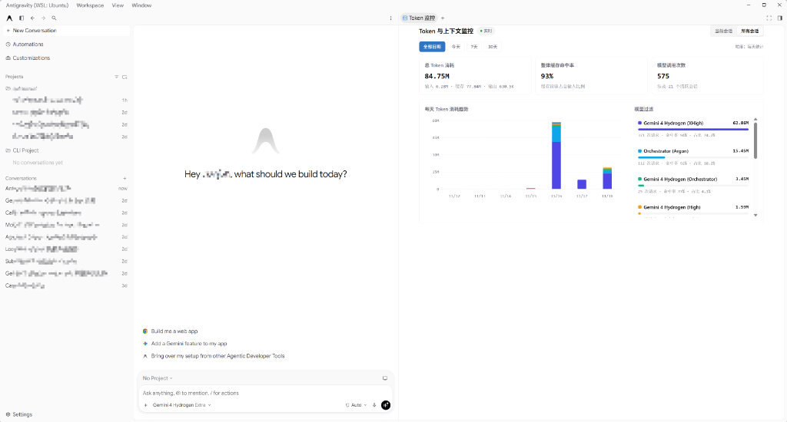

# Antigravity Token Monitor

一个用于 **Google Antigravity** 的自定义 UI 插件（Sidecar），在右侧辅助面板中实时展示**当前会话的上下文窗口占用**以及**所有历史会话的 Token 消耗趋势与模型分布**。

## 效果预览



## 功能特性

### 1. 当前会话监控
- **上下文窗口实时水位**：自动从 Antigravity Language Server 读取当前模型的真实上下文窗口上限（`maxContextTokens`），以进度条展示已用/剩余 Token 及使用比例（60% 黄色预警，85% 红色告警）。
- **核心指标卡片**：实时展示最新一轮提示词的**缓存命中率**、**最新一轮消耗**（新增输入 / 缓存读取 / 输出）以及**本会话累计消耗**。
- **每步消耗明细**：默认展开展示当前会话最近各步骤（`PLANNER_RESPONSE`）的输入、缓存、输出构成与时间线（支持点击收起/展开）。

### 2. 所有会话统计与趋势分析
- **多维度时间范围**：支持切换 **全部日期**、**今天**、**7天**、**30天**。
  - 选择 **今天** 时自动按 **每小时（00:00 - 23:00）** 聚合；
  - 选择 **全部日期 / 7天 / 30天** 时按 **每天** 聚合。
- **堆叠柱状图**：按模型分色堆叠展示每日或每小时的 Token 消耗趋势，鼠标悬停可查看精确时间段与各模型拆分用量。
- **右侧模型列表过滤**：汇总展示所有模型（包括桌面端、CLI `antigravity-cli` 及 Subagent / Swarm 等子代理会话）的调用次数、总 Token、缓存命中率与占比；点击任意模型可单独筛选左侧图表与汇总指标。

### 3. 原生主题与跨版本兼容
- 自动加载宿主 `/preload.js` 同步 Antigravity 深色 / 浅色主题配色。
- 纯原生 Node.js ESM + HTML/SVG/CSS，零外部第三方 npm 依赖，无任何外部网络请求。
- 通过 `sidecar_sdk` 与环境变量动态定位会话日志，不依赖固定客户端版本号，Antigravity 升级后可持续使用。

---

## 目录结构

```text
token-monitor/
├── plugin.json                      # 插件清单
├── README.md                        # 说明文档
├── assets/
│   ├── logo.svg                     # 插件图标
│   └── preview.png                  # 效果图预览
└── sidecars/
    └── dashboard/
        ├── package.json             # ESM 模块声明
        ├── sidecar.json             # Sidecar 与辅助面板入口配置
        ├── main.mjs                 # 本地统计后端（基于 sidecar_sdk）
        └── index.html               # 面板前端界面
```

---

## 安装方式

### 方式一：安装为全局插件（推荐，所有项目可用）

将本仓库克隆或复制到 Antigravity 全局插件目录 `~/.gemini/config/plugins/token-monitor/`：

**macOS / Linux：**
```bash
mkdir -p ~/.gemini/config/plugins
git clone https://github.com/rupyerlua/antigravity-token-monitor.git ~/.gemini/config/plugins/token-monitor
```

**Windows (PowerShell)：**
```powershell
New-Item -ItemType Directory -Force "$env:USERPROFILE\.gemini\config\plugins"
git clone https://github.com/rupyerlua/antigravity-token-monitor.git "$env:USERPROFILE\.gemini\config\plugins\token-monitor"
```

### 方式二：安装为项目级插件（团队共享）

将仓库内容放入目标项目的 `.agents/plugins/token-monitor/` 目录中即可随项目生效。

---

## 使用说明

1. 安装后重启或打开 Antigravity（或前往设置中的 **Customizations / Plugins** 确认 `Token Monitor` 已启用）。
2. 在对话右上角的辅助面板菜单中打开 **Token 监控**，或在聊天框中通过 `[Token 监控](sidecar://token-monitor/dashboard/)` 快捷唤出。
3. 面板默认每 2 秒自动轮询刷新一次。

---

## 工作原理与隐私说明

- **纯本地运行**：开启插件后，Antigravity Language Server 会在本机启动一个仅监听 `127.0.0.1` 随机空闲端口的轻量 Node.js Sidecar 服务，不会暴露到局域网或公网。
- **数据来源**：只读解析本机 `~/.gemini/*/brain/<conversation-id>/.system_generated/logs/transcript.jsonl` 与本地 Language Server 的 `GetCascadeTrajectoryGeneratorMetadata` 元数据（用于识别子代理模型与真实上下文上限），并仅在 `ANTIGRAVITY_EXECUTABLE_DATA_DIR` 下缓存元数据索引。
- **零数据外传**：所有统计计算均在本机完成，不会向任何第三方服务器发送对话内容或统计数据。

---

## 环境要求

- Google Antigravity 桌面端（内置 `sidecar_sdk` 与 Node.js 运行时）

## License

MIT
